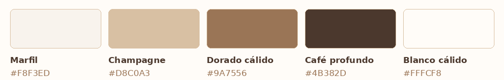

<div align="center">
  
</div>

# Novias Julieta

**Boutique de vestidos en el centro de La Barca, Jalisco**

Escaparate digital elegante y minimalista: catálogo visual por colección y contacto directo por WhatsApp.
Sin carrito de compras y sin pasarela de pagos.

</div>

---

## Qué es este sitio

Novias Julieta vende vestidos y artículos para celebraciones religiosas y familiares. La web funciona
como vitrina: presenta las colecciones, muestra modelos con fotografía editorial y lleva a la cliente a
WhatsApp para consultar disponibilidad, precios o una cita en la tienda.

**Colecciones que se venden**

- Vestidos de novia
- Vestidos de XV años
- Vestidos de primera comunión
- Trajes de primera comunión
- Vestidos y trajes de bautizo para bebé
- Accesorios y artículos religiosos

## Páginas

| Ruta | Nombre | Contenido |
| --- | --- | --- |
| `/` | Inicio | Portada editorial, tarjetas de colecciones y modelos destacados |
| `/catalogo` | Catálogo | Grid de modelos con filtros por colección (`/catalogo?cat=xv`, `?cat=novia`, …) |
| `/nosotros` | Nosotros | Historia de la boutique en dos columnas |
| `/contacto` | Contacto | Datos del local, mapa y formulario |
| cualquier otra | 404 | Página de no encontrado con enlace de regreso |

Encabezado, pie de página y botón flotante de WhatsApp son compartidos: se ven igual en todas las páginas.

## Modelos del catálogo

Cada tarjeta tiene un botón **"Consultar disponibilidad"** que abre WhatsApp con el mensaje ya escrito.

| Modelo | Colección | Descripción |
| --- | --- | --- |
| Modelo Aurora | Vestidos de novia | Corte sirena con encaje bordado y cola catedral |
| Modelo Celeste | Vestidos de novia | Encaje floral strapless con caída de tul |
| Modelo Valentina | Vestidos de XV años | Corte princesa champagne con aplicaciones florales |
| Modelo Azucena | Vestidos de primera comunión | Tul y encaje con lazo de satín en la cintura |
| Traje Santiago | Trajes de primera comunión | Saco, chaleco y moño en tono marfil |
| Ropón Gracia | Bautizo | Ropón de encaje con gorrito a juego |
| Set Bendición | Accesorios | Rosario de perla, vela, tiara y velo de encaje |

## Identidad visual

Combinación de elegante y lujosa, moderna y minimalista, romántica y tradicional.



| Color | Hex | Se usa para |
| --- | --- | --- |
| Marfil | `#F8F3ED` | Fondos principales |
| Champagne | `#D8C0A3` | Líneas, bordes y acentos |
| Dorado cálido | `#9A7556` | Enlaces, etiquetas y detalles |
| Café profundo | `#4B382D` | Pie de página y textos sobre claro |
| Blanco cálido | `#FFFCF8` | Tarjetas y secciones alternas |

**Tipografías**

- **Títulos:** Cormorant Garamond (serif elegante)
- **Textos:** Montserrat (sans-serif moderna)

## Stack técnico

| Pieza | Uso |
| --- | --- |
| TanStack Start (React 19, Vite) | Enrutado por archivos, renderizado en servidor, `head()` por página |
| Tailwind CSS v4 | Diseño y tokens de color en `src/styles.css` |
| Motion (`motion/react`) | Animaciones y microinteracciones |
| lucide-react | Iconos |
| zod | Validación del formulario de contacto |
| Vitest + Testing Library | Prueba de rutas |

## Estructura

```text
.
├── docs/
│   ├── logo-novias-julieta.png    Logo para este README
│   └── paleta.png                 Muestra de la paleta de colores
├── public/
│   ├── favicon.png                Icono de la pestaña del navegador
│   ├── images/                    Logos SVG autónomos (dorado y champagne)
│   └── robots.txt
└── src/
    ├── assets/                    Fotografías del catálogo (JPG) y punteros del logo
    ├── components/
    │   ├── Layout.tsx             Encabezado, pie de página, botón flotante de WhatsApp
    │   ├── Logo.tsx               Logo (variante dorada y variante champagne)
    │   ├── ProductGrid.tsx        Tarjetas de modelos con filtro
    │   └── ui/                    Componentes base
    ├── lib/
    │   ├── catalog.ts             Colecciones y modelos
    │   ├── site.ts                Teléfono, WhatsApp, dirección, horarios
    │   └── utils.ts
    ├── routes/
    │   ├── __root.tsx             Plantilla común: <head>, encabezado, pie, 404
    │   ├── index.tsx              /
    │   ├── catalogo.tsx           /catalogo
    │   ├── nosotros.tsx           /nosotros
    │   └── contacto.tsx           /contacto
    ├── styles.css                 Paleta, tipografías y estilos de botones
    └── test/                      Prueba de enrutado
```

## Cómo correrlo

Se usa **bun** como gestor de paquetes.

```bash
bun install        # instalar dependencias
bun run dev        # entorno de desarrollo
bun run build      # compilar para producción
bun run preview    # ver la versión compilada
bun run lint       # revisar código
bun run format     # dar formato
bun run test       # ejecutar las pruebas
```

## Cómo personalizarlo

| Quiero cambiar… | Edito… |
| --- | --- |
| Teléfono, WhatsApp, dirección, horarios, correo | `src/lib/site.ts` (un solo lugar, se aplica en todo el sitio) |
| Colecciones, nombres de modelos, descripciones | `src/lib/catalog.ts` |
| Una fotografía | Reemplazar el JPG correspondiente en `src/assets/` (mismo nombre de archivo) |
| Colores o tipografías | `src/styles.css` (tokens de la paleta y `--font-serif` / `--font-sans`) |
| El logo | `src/components/Logo.tsx` y los SVG en `public/images/` |
| El mensaje que se envía por WhatsApp | `WA_MSG` en `src/components/Layout.tsx` |

El formulario de contacto valida nombre, teléfono, colección de interés y mensaje, y al enviarlo abre
WhatsApp con todos los datos ya redactados. No guarda información en una base de datos.

Los logotipos del encabezado y pie de página se sirven desde `/images/novias-julieta-logo.svg`
y `/images/novias-julieta-logo-champagne.svg`. Ambos archivos están incluidos físicamente en el
repositorio y contienen la imagen original incrustada sin pérdida: mantienen colores, transparencia
y proporciones de 794 × 290, sin depender de fuentes externas ni de servidores de Lovable.
Para un despliegue externo, publica los cambios y conserva el contenido de `public/` como archivos estáticos.

## Detalles ya incluidos

- Animaciones suaves: aparición con desplazamiento en portada y colecciones, zoom lento en la foto principal,
  estados al pasar el cursor en botones y fotos.
- Navegación fija con menú desplegable de colecciones y menú para móvil.
- Botón flotante de WhatsApp accesible (con etiqueta para lectores de pantalla).
- Datos de contacto y WhatsApp centralizados y configurables.
- Título, descripción y vista previa distinta en cada página para compartir en redes.
- Fotografías de catálogo generadas para la muestra: conviene sustituirlas por fotos reales de la tienda.

## Contacto

**Novias Julieta** · Juárez #19, Col. Centro, La Barca, Jalisco, México
Tel. y WhatsApp: **393 100 1337** · Lunes a sábado 10:00–20:00, domingo 11:00–15:00
